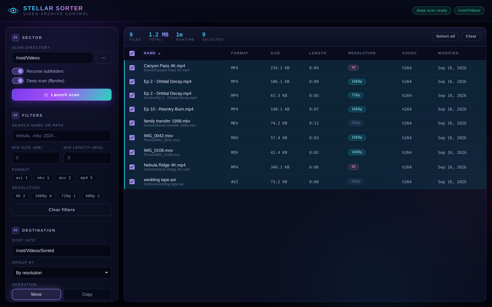

# Stellar Sorter

A video file sorting application with a dark intergalactic theme — a browser UI
plus a matching command line, both driving the same engine.

Point it at a directory, see every video file with its real size, length,
resolution and codec, sort and filter on any of those, then file everything into
folders by a rule you pick. Nothing moves until you review the plan and confirm.



## Running it

No dependencies — standard library only, Python 3.10+.

```bash
python3 -m video_sorter serve ~/Videos          # opens http://127.0.0.1:8770
```

`ffmpeg` is optional but recommended: the sorter calls `ffprobe` for duration,
resolution, codec and bitrate. Without it everything still works, sorting by
name, size and date, and the probe-derived columns read `Unknown`.

```bash
brew install ffmpeg          # macOS
sudo apt install ffmpeg      # Debian/Ubuntu
```

## The command line

```bash
# Look before you leap
python3 -m video_sorter list ~/Videos --sort size --desc
python3 -m video_sorter list ~/Videos --resolution 4K --min-duration 20

# Sort — a dry run unless you pass --apply
python3 -m video_sorter sort ~/Videos --into ~/Videos/Sorted --by resolution
python3 -m video_sorter sort ~/Videos --into ~/Videos/Sorted --by year --apply

# Change your mind
python3 -m video_sorter undo --latest          # dry run
python3 -m video_sorter undo --latest --apply
```

### Grouping rules (`--by`)

| Rule | Folders you get |
|------|-----------------|
| `resolution` | `8K/` `4K/` `1440p/` `1080p/` `720p/` `480p/` `SD/` |
| `duration` | `Clips/` (<1m) `Shorts/` (<10m) `Episodes/` (<45m) `Features/` |
| `size` | `Tiny/` (<100MB) `Small/` (<1GB) `Medium/` (<5GB) `Large/` (<20GB) `Huge/` |
| `extension` | `MP4/` `MKV/` `MOV/` … |
| `year` | `2024/` `2025/` … |
| `month` | `2024/2024-03/` … |
| `codec` | `h264/` `hevc/` `av1/` … |
| `alpha` | `A/` `B/` … `#/` for names not starting with a letter |
| `folder` | keeps each file's current folder name |
| `flat` | no subfolders |

### Sort keys (`--sort`)

`name` (natural order, so *Ep 2* precedes *Ep 10*), `size`, `duration`,
`resolution`, `bitrate`, `codec`, `extension`, `modified`, `created`, `folder`,
`path`.

Files whose probe data is unknown sort to the end in **both** directions — a
file with no measured duration is not the shortest, it is unmeasured.

## What it will not do

The sorter moves files, so it is deliberately conservative:

- **Nothing is ever overwritten.** A name that already exists at the
  destination, or a second file heading for the same name, gets a ` (2)`
  suffix. On macOS and Windows that check is case-insensitive, matching how
  those filesystems actually behave.
- **Dry run is the default.** Both `sort` and `undo` show you the plan and
  change nothing until `--apply`. The UI always shows the full plan first.
- **Every run is journalled** to `~/.local/share/video_sorter/journals/`,
  written as it goes, so even an interrupted run can be undone.
- **Undo never deletes.** It reverses moves. Files placed by `--copy` are
  reported and left alone — removing them is your call.
- **One failure does not strand the rest.** An unwritable file is recorded and
  the run continues.

## Security

The server can move files, so:

- It binds to **127.0.0.1** by default. Binding elsewhere prints a warning.
- All file access is **confined to `--root`** (defaults to the directory you
  opened). Traversal and symlinks pointing outside it are refused.
- Every API call must carry a **per-process token** embedded in the page, so
  another site the user has open cannot drive it. Cross-origin requests are
  rejected outright.
- `apply` **re-plans server-side** from the same inputs rather than trusting a
  plan sent by the client.

## Layout

| File | What it does |
|------|--------------|
| `metadata.py` | `VideoFile`, the ffprobe call, and the bucket labels |
| `scanner.py` | directory walking, parallel probing, the probe cache |
| `sorter.py` | sort keys, filters, summary stats |
| `organizer.py` | move planning, collision handling, apply, journal, undo |
| `server.py` | the local HTTP API and its confinement rules |
| `cli.py` | `serve` / `list` / `sort` / `undo` |
| `static/` | the interface — `index.html`, `app.css`, `app.js` |

## Tests

```bash
python3 -m unittest discover -s tests -v
```

No ffprobe or video data needed: probe results are injected through the same
function that parses real ffprobe output.
